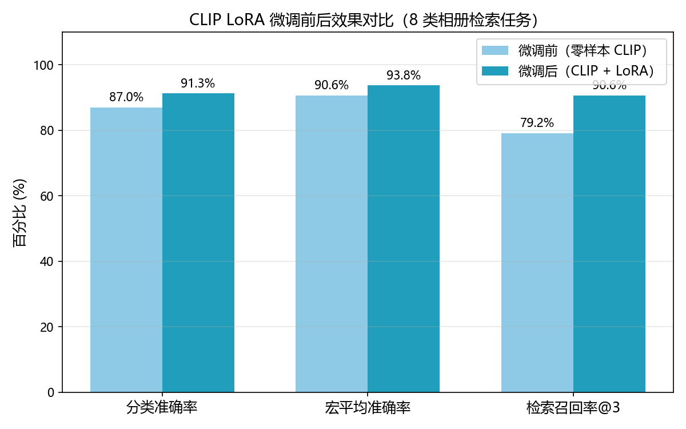

# 多模态相册（Multimodal Album）

基于 **CLIP 图文对比学习模型** 的本地智能相册：支持**文字搜图、以图搜图、零样本自动打标**，并完成 **LoRA 微调**，模型与数据全部离线运行。

## 功能

| 功能 | 说明 |
|---|---|
| 🔍 文字搜图 | 用自然语言在相册里找照片，**中英文自动识别**（英文用 CLIP，中文自动切换 Chinese-CLIP）|
| 🖼️ 以图搜图 | 上传一张照片，找出视觉上/语义上最相似的其它照片 |
| 🏷️ 零样本自动打标 | 不用训练，自动给照片贴标签（人像/风景/美食/宠物…）并给出置信度 |
| 🎓 LoRA 微调 | 在自有照片上微调 CLIP，检索/分类效果显著提升 |
| 🌐 接口服务 | FastAPI 提供 REST 接口，方便对接其它系统 |
| 🖥️ 图形界面 | Gradio 网页界面，开箱即用 |

## 技术栈

- **CLIP**（openai/clip-vit-base-patch32，经 Transformers 加载，本地 safetensors 离线运行）
- **LoRA 微调**（peft，冻结主干、只训练 0.65% 参数）
- **FAISS** 向量检索（余弦相似度，IndexFlatIP）
- **PyTorch / CUDA**（RTX 3050 4GB 可跑）
- **FastAPI + Gradio** 服务化与界面

## 核心原理

1. CLIP 把图片和文字映射到同一个 512 维"语义向量空间"：相似的图文，向量靠得近。
2. 建索引时，把相册每张照片都变成向量，存入 FAISS（**英文、中文各建一套索引**）。
3. 搜图时，把查询文字/图片也变成向量，用 FAISS 找最近的 N 个向量，对应照片就是结果。
4. **中文检索**：英文 CLIP 的分词器读不懂中文，故额外接入 Chinese-CLIP（OFA-Sys/chinese-clip-vit-base-patch16，本地离线）。文字搜索自动检测查询语言，中文走中文索引、英文走英文索引，互不干扰。
5. **微调**：在自有照片上，用"图片 ↔ 类别描述"的对比学习损失（InfoNCE）训练 LoRA 适配器，让 CLIP 更懂你的相册。

### 命令行方式

```bash
cd /d D:\项目\多模态相册

# 建立索引（GPU 加速，约 200 张 < 30 秒）
python main.py index

# 命令行搜图
python main.py search "a dog running in the park"

# 启动网页界面 / API
python main.py ui
python main.py api
```

## 第二阶段：CLIP LoRA 微调

### 结果（8 类相册检索任务，测试集 23 张）

| 指标 | 微调前（零样本） | 微调后（CLIP+LoRA） | 提升 |
|---|---|---|---|
| 分类准确率 | 86.96% | **91.30%** | **+4.3 个百分点** |
| 宏平均准确率 | 90.62% | **93.75%** | +3.1 |
| 检索召回率@3 | 79.17% | **90.62%** | **+11.5 个百分点** |



弱类别改善：猫分类 50%→75%、运动类检索召回率 33%→100%。

### 复现

```bash
python main.py split      # 划分训练/测试集
python main.py baseline   # 微调前评估
python main.py finetune   # LoRA 微调（默认 25 epochs，约 1 分钟）
python main.py eval_ft    # 微调后评估
# 或一键跑完：
python main.py phase2
```

微调参数：LoRA r=16, alpha=32, dropout=0.1，只训练注意力层的 q/k/v/out 投影（0.65% 参数），
对比损失 InfoNCE，lr=5e-5，batch=8，25 epochs，fp16 混合精度，4GB 显存可跑。

## 项目结构

```
多模态相册/
├── app/
│   ├── clip_service.py   # CLIP 模型封装（图片/文字 -> 向量）
│   ├── indexer.py        # 建索引 / 读索引
│   ├── retriever.py      # 文字搜图 / 以图搜图
│   ├── tagger.py         # 零样本自动打标
│   ├── dataset.py        # 数据集加载与训练/测试划分
│   ├── finetune.py       # CLIP LoRA 微调
│   └── evaluate.py       # 分类准确率 + 检索 Recall@K 评估
├── api/server.py         # FastAPI 接口
├── ui/app.py             # Gradio 界面
├── scripts/
│   ├── download_demo_data.py      # 从维基共享资源下载带标签演示照片
│   ├── download_picsum.py         # 从 picsum 补充通用照片
│   ├── download_chinese_clip.sh   # 下载中文 CLIP 模型（hf-mirror）
│   └── plot_comparison.py         # 生成微调前后对比图
├── data/
│   ├── images/           # 相册照片（约 200 张，含 8 类带标签照片）
│   ├── index/            # FAISS 索引 + 元数据
│   ├── split.json        # 训练/测试划分
│   └── manifest.json     # 照片清单
├── models/
│   ├── clip-vit-base-patch32-local/        # 英文 CLIP 本地模型（离线可用）
│   ├── chinese-clip-vit-base-patch16-local # 中文 CLIP 本地模型（中文检索用）
│   └── clip-lora-album/                    # 微调后的 LoRA 适配器
├── docs/
│   └──效果对比.png
└── README.md
```

## 数据说明

- 带标签演示照片来自 **维基共享资源（Wikimedia Commons）**，通用照片来自 **picsum.photos**，均为可自由使用的公开图片。
- `manifest.json` 记录了每张照片的类别标签（dog/cat/...），用于微调与效果评估。

## 后续规划

- [ ] 增量索引：新照片加入时只对新照片建向量
- [ ] 混合检索：CLIP 向量 + 关键词（BM25）融合
- [ ] 更大的自有数据集上继续微调
